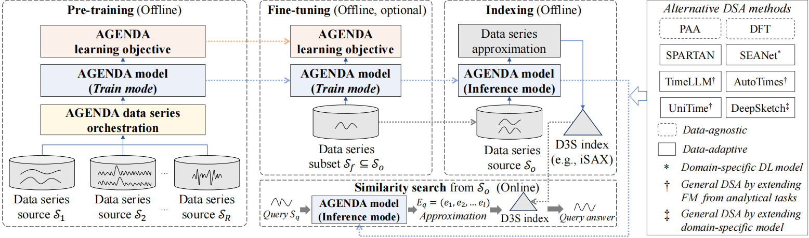

<h1 align="center">AGENDA
</h1>
<h2 align="center"> A General Deep Approximation Framework for Data Series Similarity Search</h2>

## Overview

This system aims to demonstrate the feasibility of AGENDA, a general deep learning-based data series approximation (DSA) framework for similarity search, and provide insight into how it achieves better data series similarity search (D3S) performance than existing DSA solutions.

## AGENDA Framework

AGENDA pre-trains a general and lightweight base approximation model using large-scale heterogeneous data series from diverse domains and subsequently adapts to target domains via efficient fine-tuning or zero-shot inference. This design enables accurate and computationally efficient similarity search across diverse data series domains, while significantly reducing training and deployment costs. It features three novel components, including:
1. A lightweight and general AGENDA model that efficiently embeds heterogeneous data series from multiple sources into unified representation for approximation;
2. A novel AGENDA objective that encourages the model to learn high-quality data series representations for similarity search;
3. A customized curriculum learning method that orchestrates multi-source pre-training data series to improve representation quality and pre-training efficiency.



## Baseline

The following methods are used as baselines：

| Baseline method                      |                                                                                                                                    Description                                                                                                                                    |
| :--------------------------- | :-------------------------------------------------------------------------------------------------------------------------------------------------------------------------------------------------------------------------------------------------------------------------------: |
| [PAA](https://link.springer.com/article/10.1007/PL00011669)                      |                                                             Piecewise Aggregate Approximation, a classic dimensionality reduction technique that reduces the volume of time series data by dividing the sequence into equal segments and calculating the mean value for each segment.                                              |
| [SPARTAN](https://dl.acm.org/doi/abs/10.1145/3725357)                         |                        is a data-adaptive data series approximation method that transforms data series into reduced representation using principle component analysis (PCA). It also includes a dynamic symbolic encoding method that allocates the encoding budget based on the importance of each dimension.                       |
| [TimeLLM](https://arxiv.org/abs/2310.01728)                         |                                                                             repurposes a frozen LLM for time-series modeling by “reprogramming” the input series into text-prototype/patch representations to align modalities.                                                                             |
| [AutoTimes](https://arxiv.org/abs/2402.02370)                        |                                                                                             projects time series into a decoder-only LLM’s token-embedding space and uses its autoregressive generation capability to produce future predictions (as the learned representation).                                                                                            |
| [DFT](https://link.springer.com/chapter/10.1007/3-540-57301-1_5)                         |                                                     The discrete Fourier transform maps a time series to the frequency domain, where a small set of Fourier coefficients can be used as a compact embedding for similarity search.                                                     |
| [SEANet](https://ieeexplore.ieee.org/document/10107902)                          |                         is a method that learns Deep Embedding Approximations (DEA) so neural embeddings can replace classical approximations for accurate approximate similarity search over data series.                          |
| [UniTime](https://arxiv.org/abs/2310.09751)                          |                         is a language-empowered unified model that uses domain instructions with a Language-TS Transformer to generalize time-series representations across domains.                          |
| [DeepSketch](https://doi.org/10.14778/3685800.3685877)                          |                         adapts a geometric loss that learns representations close to the embedding of a reference DSA method.                          |

## Dataset
The current evaluation includes the following datasets:

| Dataset                      |                                                                                                                                    Description                                                                                                                                    |
| :--------------------------- | :-------------------------------------------------------------------------------------------------------------------------------------------------------------------------------------------------------------------------------------------------------------------------------: |
| [Astro](https://ln5.sync.com/dl/0b8135230/39vxx8su-tkfi7t2s-dgsvh8rp-k8ixcs8p?sync_id=12175200410004)                      |                                                             is a benchmark astronomical time series dataset consisting of fixed-length (256) stellar light curves                                                    |
| [Deep1B](https://ln5.sync.com/dl/0b8135230/39vxx8su-tkfi7t2s-dgsvh8rp-k8ixcs8p?sync_id=12175200410004)                         |                        is a large-scale vector similarity search benchmark released by Facebook, consisting of 1 billion 96-dimensional feature vectors extracted from deep neural networks.It is widely used to evaluate the scalability and efficiency of approximate nearest neighbor search methods.                        |
| [FreqSpectra](https://github.com/boyankolev/tsgen-ifft)                         |                                                                             is a synthetic time-series dataset consisting of fixed-length sequences (256). Each sequence is generated in the frequency domain by selecting a small number of dominant frequency components and then transformed into the temporal domain via inverse discrete Fourier transform (IDFT).                                                                             |
| [RandWalk](https://github.com/karimaechihabi/lernaean-hydra)                        |                                                                                             is a synthetic time-series dataset generated by a random walk process, where each sequence evolves as the cumulative sum of Gaussian noise. All sequences have a fixed length of 256 and are z-normalized before retrieval.                                                                                            |
| [SALD](https://ln5.sync.com/dl/0b8135230/39vxx8su-tkfi7t2s-dgsvh8rp-k8ixcs8p?sync_id=12175200410004)                         |                                                     is a real-world neuroscience time-series dataset consisting of fixed-length sequences of 128, which represent neural activity recorded during experimental tasks.                                                     |
| [Seismic](https://ln5.sync.com/dl/0b8135230/39vxx8su-tkfi7t2s-dgsvh8rp-k8ixcs8p?sync_id=12175200410004)                          |                         is a real-world time-series dataset from seismology, consisting of fixed-length segments(256) of ground motion recordings.                          |

## Index

The following D3S indexes are included in the current evaluation: 

| Index method                      |                                                                                                                                    Description                                                                                                                                    |
| :--------------------------- | :-------------------------------------------------------------------------------------------------------------------------------------------------------------------------------------------------------------------------------------------------------------------------------: |
| [iSAX](https://dl.acm.org/doi/10.1145/1401890.1401966)                      |                                                             is a multi-resolution symbolic index that enables scalable time series similarity search through adaptive refinement of SAX representations.                                              |
| [DIDS](https://dl.acm.org/doi/10.14778/3665844.3665851)                         |                        introduces reference-point-based summarizations to improve the pruning rate by the sorted-based representation strategy. Moreover, DIDS employs reference points and a cost model to cluster similar data series, and uses a graph-based approach to interconnect various regions, enhancing approximate search capabilities.                       |
| [Dumpy](https://dl.acm.org/doi/10.1145/3588965)                         |                                                                             is a data-adaptive index structure designed for scalable similarity search over large data series collections. Unlike traditional index structures that rely on fixed fan-out or uniform partitioning, Dumpy dynamically adapts its node arity and partitioning strategy according to the data distribution, thereby avoiding index degeneration under skewed or high-dimensional data.                                                                             |


## Usage

The system uses Python 3, Streamlit, Plotly, NumPy, and pandas. Data collections, DSA methods, and D3S indexes are registered through one configuration file. The adapters prepare their artifacts from the registered data and expose them to the four interactive workspaces.

#### Install the system

```bash
git clone https://github.com/paradox0503/AGENDA.git
cd AGENDA
python -m venv .venv
```

Activate the environment:

```bash
# Linux / macOS
source .venv/bin/activate
# Windows PowerShell
.venv\Scripts\Activate.ps1
```

Install the system and the dependencies needed by your adapters:

```bash
python -m pip install -r requirements.txt
```

Alternatively, run `conda env create -f environment.yml` and `conda activate AGENDA`.

#### Register datasets, methods, and indexes

Copy `config.example.json` to `config.json`, then configure the registrations. Paths in the configuration are relative to its directory. The `artifacts` setting specifies the output root. Each registration has a unique `id`; its `name` is displayed in the interface.

**Datasets.** The `data` entry points to a numeric `[number_of_series, series_length]` matrix. Use `format: "npy"` for a NumPy array or `format: "f32"` with `shape: [number_of_series, series_length]` for a row-major little-endian float32 file. Each collection may have its own length and number of series. Rows must contain finite values. Apply the desired normalization consistently to indexed series and queries before import.

The `queries` entry supports two forms:

```json
{"path": "data/query_ids.npy", "kind": "ids"}
```

This is a one-dimensional NumPy integer array of row IDs in the data matrix. Queries use the corresponding series, and search excludes that row from the answers.

```json
{"path": "data/queries.npy", "kind": "series", "format": "npy"}
```

This is a separate query matrix with the same series length as the collection. Separate queries are assigned internal negative handles and are evaluated against all indexed rows. Omitting `queries` makes collection rows available as query examples. Single Query also accepts a one-column CSV in the same input space.

**DSA methods.** Each method specifies `dimensions`, `factory`, and `options`. A factory such as `adapters.encoder:EncoderAdapter` names an importable Python class; `options` are passed to its constructor. The adapter can wrap an installed library, a trained model, or a separately managed service. Its interface is defined by `DSAPlugin` in `backend/plugins.py`:

| Method | Responsibility |
| --- | --- |
| `fit(data, artifact_dir)` | Train, adapt, or initialize the method on the supplied collection and save the state needed for subsequent inference. A pretrained integration may initialize from its configured checkpoint. |
| `load(artifact_dir)` | Restore that state. |
| `transform(rows)` | Return a finite numeric array of shape `[len(rows), dimensions]`. The pipeline calls this in batches. |
| `approximate(query, cardinality)` | Return `backend.contracts.Approximation` with one query's `coefficients`, optional `reconstructed` values, and optional integer `symbols`. Use empty arrays for optional outputs. Query and batch encodings must share the same representation space. |

Additional catalog fields include `group`, `description`, and optional `flops` (GFLOPs) and `params` (millions of parameters). These fields populate method cards and efficiency views. The sidebar reads all methods from the registry. Optional `presets` map preset names to lists of method IDs.

**D3S indexes.** Each index has a `factory` and constructor `options`. The `IndexPlugin` interface in `backend/plugins.py` defines:

| Method | Responsibility |
| --- | --- |
| `build(data, representations, artifact_dir)` | Build and persist the index for the supplied collection and DSA representation matrix. |
| `load(data, representations, artifact_dir)` | Open its persisted files for queries. |
| `describe()` | Return the nodes and physical statistics used by the index explorer. |
| `search_curve(request)` | Execute a budgeted query and return snapshots keyed by the requested budgets. |

`IndexRequest` contains the raw query, encoded query, indexed data, `top_k`, `exclude_id`, requested `budgets_ms`, and measured `encoding_ms`. Budgets include encoding time. The plugin returns a distinct `SearchResult` for each requested budget, capturing the answers and counters at that point in the same execution. An exhausted budget yields the answers obtained so far. Plugins may include index traversal, I/O, and candidate distance work according to the implementation's search procedure.

`SearchResult` contains:

- `ids`: unique integer row IDs into the indexed collection, excluding `exclude_id`.
- `distances`: the corresponding finite distances, in answer order.
- `nodes`: the index nodes used by the replay view.
- `trace`: ordered traversal events up to that snapshot.
- `metrics`: query timings and work counters measured by the adapter.

For timings, `metrics["estimated_ms"]` is the measured total elapsed query time at the snapshot, including encoding, rather than a predicted duration. Additional fields are `io_ms`, `candidates` (raw distance computations), `lb_checks`, `leaves_read`, `pruned_leaves`, `pruned_nodes`, `pruned_series`, and `series_excluded_by_lb`. The wrapper records measured query encoding as `encoding_ms`. Adapters should report the counters their implementation measures; these counters drive the tables and charts.

`describe()` returns `{"nodes": [...], "leaf_pages": integer}`. Every node has `id`, `parent`, `children`, `label`, `depth`, and `ids` (representative indexed row IDs). Node IDs are unique nonnegative integers, parents precede children, and roots have `parent: null`. Optional fields include `size`, `leaf_pages`, `cardinalities`, `split_dimensions`, and `index_type`. Supply a tree hierarchy for the structure visualization; an index with another topology can expose a tree projection for this view.

Each trace event contains `node`, `action`, and `label`. Supported action labels are `expand`, `scan`, `partial scan`, `prune`, `heuristic prune`, and `priority queue`. Events can include `lower_bound`, `bsf`, `comparison_bsf`, `distance_computations`, `pruned_series`, `cumulative_distance_computations`, and `cumulative_pruned_series`. These values appear in hover details and current/cumulative replay cards. The index plugin determines each event and its statistics from the query execution.

The six dataset collections, nine full DSA methods, and three index families described above can be registered through this same interface, together with additional collections or methods. Registrations determine which combinations appear in the system. Each registered implementation supplies its own model and index-specific behavior through the common contracts.

#### Add a DSA method or D3S index

Place local integration code in the `adapters/` package. For example, adding a DSA method called MyDSA and a D3S index called MyIndex can use this layout:

```text
AGENDA/
    app.py
    prepare.py
    config.json
    adapters/
        __init__.py
        my_dsa.py       # defines MyDSAAdapter
        my_index.py     # defines MyIndexAdapter
```

Implement the DSA lifecycle methods listed above in `MyDSAAdapter` and the index lifecycle methods in `MyIndexAdapter`. Then append the following objects to the `methods` and `indexes` arrays in `config.json`, respectively:

```json
{
  "id": "my_dsa",
  "name": "MyDSA",
  "dimensions": 16,
  "factory": "adapters.my_dsa:MyDSAAdapter",
  "options": {}
}
```

```json
{
  "id": "my_index",
  "name": "MyIndex",
  "factory": "adapters.my_index:MyIndexAdapter",
  "options": {}
}
```

The `factory` syntax is **`python.module.path:ClassName`**. For `adapters.my_dsa:MyDSAAdapter`, the loader imports `adapters/my_dsa.py`, locates `MyDSAAdapter`, and instantiates it with the keyword arguments in `options`. This is equivalent to:

```python
from adapters.my_dsa import MyDSAAdapter

adapter = MyDSAAdapter(**registration["options"])
```

| Name | Purpose | Naming rule |
| --- | --- | --- |
| `id` | Internal selection key and generated artifact directory name | Unique within its registry; letters, digits, underscores, and hyphens |
| `name` | Human-readable label in the frontend | Any descriptive display name |
| Module filename | Location of the adapter code | An importable Python module, conventionally `snake_case.py` |
| Class name | Adapter instantiated by the loader | An importable callable, conventionally a `PascalCase` class |
| `factory` | Connection from registration to implementation | Must match the actual module path and class name |

The registration ID, filename, and class name may differ. The `factory` field connects them explicitly. An installed package can also supply an adapter, for example `my_package.encoders:MyDSAAdapter`. Run commands from the repository root so local `adapters` modules are importable, or install the integration package in the same Python environment. Paths in adapter `options` are passed directly to its constructor; the adapter resolves any checkpoint or library-specific paths it accepts.


#### Prepare artifacts

```bash
python prepare.py --config config.json
```

The pipeline reads each registered collection, initializes each selected DSA adapter, batch-encodes its series, and builds each selected index over those representations. The generated files have the following organization:

```text
artifacts/<dataset_id>/<method_id>/
    manifest.json
    representations.npy
    <adapter-managed model files>
    indexes/<index_id>/
        manifest.json
        <adapter-managed index files>
```

Existing artifacts are reused when their configuration and source-file metadata match. Input file paths, sizes, modification times, and registration options determine the signature. Use `--force` after changing adapter code or model checkpoints, or whenever artifacts need rebuilding. Select individual registrations with:

```bash
python prepare.py --config config.json --datasets collection --methods encoder --indexes search_index
python prepare.py --config config.json --force
```

Install or place each adapter module on Python's import path before preparing or launching. The `adapters/` directory is a convenient location for local integration modules. Constructor options, checkpoint locations, and method-specific hyperparameters are supplied by the adapter registration.

#### Launch the interface

```bash
# Linux / macOS: optional when using the default config.json
export AGENDA_CONFIG=config.json
# Windows PowerShell equivalent:
# $env:AGENDA_CONFIG="config.json"
python -m streamlit run app.py
```

Then open <http://localhost:8501> to launch the interface.


